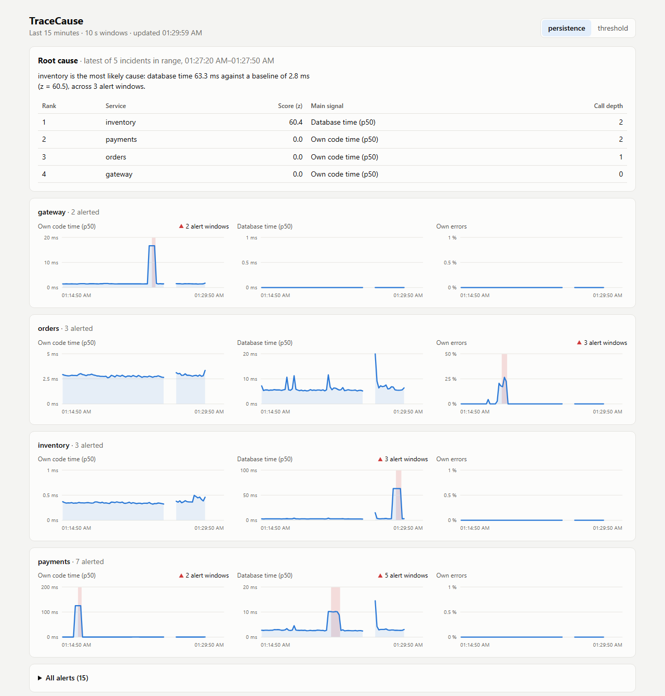

# TraceCause

Root-cause analysis on OpenTelemetry traces. A small Java microservice system
is traced end to end; faults are injected into one service at a time; the
analyzer finds the anomaly and ranks which service caused it. A naive
threshold detector is compared against a persistence-based detector in a
measured, seeded evaluation.

Detection and ranking are deterministic. The explanation shown in the
dashboard is a template filled only from the analyzer's numbers; no LLM makes
or changes any decision.

## Results

<!-- RESULTS:START -->
Held-out set: 12 incidents and 8 blips, 30 min at 10 req/s. Parameters were tuned on a separate tuning set only. Generated by `python -m eval.evaluate`; details in [`eval/results.md`](eval/results.md).

| Detector | Parameters | Incidents found | Precision | F1 | Blips alerted | Clean-time alarms | Median delay | Top-1 | Top-1 of found |
|---|---|---|---|---|---|---|---|---|---|
| threshold | k=2 | 12/12 | 60 % | 0.75 | 5/8 | 3 (15.5/h) | 11 s | 100 % | 100 % |
| persistence | k=2, windows=2 | 12/12 | 92 % | 0.96 | 0/8 | 1 (5.2/h) | 21 s | 100 % | 100 % |

Ranking ablation on the same held-out incidents (top-1 of found):

| Detector | Self-time + own errors | Total latency + total errors | Random |
|---|---|---|---|
| threshold | 100 % | 75 % | 25 % |
| persistence | 100 % | 75 % | 25 % |
<!-- RESULTS:END -->

## Quick start

Requires Docker. No local JDK or Node is needed; everything builds in containers.

```sh
docker compose up -d --build
python scripts/smoke_test.py                                 # one trace across all four services
python -m loadgen.load --rate 20 --duration 300 --seed 1 &   # seeded background load
python -m loadgen.faults set payments --slow-query-ms 150    # inject a fault...
python -m loadgen.faults clear                               # ...and remove it
```

| What | Where |
|---|---|
| Dashboard | http://localhost:3000 |
| Analyzer API | http://localhost:8000 |
| Jaeger UI | http://localhost:16686 |
| Gateway | http://localhost:8080/checkout |

The compose file has local-only default credentials. To override them, copy
`.env.example` to `.env`.



*The dashboard after a 60 ms slow-query fault in inventory: only inventory's
database time rises, and it ranks first. The breaks in the lines are minutes
without traffic.*

## How it works

```
client -> gateway -> orders -> inventory          (orders, inventory, payments use Postgres)
                          \--> payments

each service: OTel Java agent --OTLP/HTTP--> Collector --OTLP/gRPC--> Jaeger
                                                       \--OTLP/HTTP JSON--> analyzer (Python) <-- dashboard (React)
```

The analyzer turns spans into a decision in five stages:

1. **Ingest.** The Collector sends every span batch to the analyzer as OTLP JSON.
   Spans go into SQLite, keyed by (trace id, span id), so a retried batch is
   never counted twice. Fault-injector calls (`/admin/*`) are dropped.
2. **Buckets.** Each service's incoming requests (its SERVER spans) are grouped
   into 10 s windows by start time. A window is *closed* 15 s after it ends;
   only closed windows are judged, so late spans cannot make a window look quiet.
3. **Attribution.** A slow service makes every caller above it slow too, and a
   failing service makes its callers fail. So each request is reduced to what
   the service did *itself*:
   - *self-time*: span duration minus the **union** of its children's
     intervals (clipped to the span), summed over the service's spans for that
     request, split into own code time and database time;
   - *own errors*: a failed request counts only if none of the downstream
     requests it made failed.
4. **Detection.** Per service and closed window, three signals are scored:
   own-code p50, DB p50 and own-error rate. Each is a one-sided robust z-score
   against the service's previous 30 windows:
   `z = (value - median) / max(1.4826 * MAD, floor)`, with floors of 1 ms and
   0.02. Two detectors read the same scores:
   - `threshold` fires on one window with z >= k;
   - `persistence` fires when the same signal has z >= k in N consecutive windows.
5. **Ranking.** The detector's alert windows form the incident. Each service
   scores the median, over those windows, of its strongest z; ties go to the
   more downstream service in the call graph, which is built from the spans.

### Design decisions

- **Self-time and own errors before detection, not graph tricks after it.**
  Removing inherited time and errors per request makes the signal point at the
  culprit directly, so the ranking can stay simple and explainable.
- **Union, not sum, of child intervals.** Concurrent downstream calls would
  otherwise be subtracted twice and give negative self-time.
- **Median and MAD with a floor.** They ignore a few outlier windows (GC
  pauses, cold caches). The floor stops very steady signals (DB time is about
  3 ms with almost no spread) from turning a 0.3 ms wobble into a huge z.
- **One-sided scores.** Getting faster or failing less is not an incident.
- **Open-loop load.** Requests go out on a seeded Poisson schedule whether or
  not earlier ones have finished, so a slowdown is not hidden by the client
  backing off.
- **Faults are invisible in traces.** Nothing about an injected fault is
  written into spans; the analyzer has to find it from timing and status alone.
- **Record once, evaluate offline.** Live runs take minutes; tuning needs many
  passes. Recordings are replayed through the analyzer's own code.

## Faults and load

Every service has `/admin/fault` (GET, PUT, DELETE) for one active fault:

| Fault | What it does | Where it shows |
|---|---|---|
| `delayMs` | sleeps inside the request handler | the service's own code time |
| `slowQueryMs` | runs `pg_sleep` before each SQL statement | a slow database span of that service |
| `errorRate` | answers HTTP 500 with this probability (seeded) | that service's own errors; 502 upstream |

Host ports: gateway 8080, orders 8081, inventory 8082, payments 8083.

```sh
python -m loadgen.load --rate 20 --duration 60 --seed 1
python -m loadgen.faults set inventory --delay-ms 200
python -m loadgen.faults set payments --error-rate 0.3 --seed 7
python -m loadgen.faults show
python -m loadgen.faults clear
```

## Evaluation

- **Scenarios** (`eval/scenarios.py`): seeded schedules of clean gaps followed
  by one fault. *Incidents* last 40-60 s; *blips* last 4-10 s and should not
  alert. Service, fault type and a log-uniform magnitude (2-200 ms, or 2-40 %
  errors) are drawn from the seed. Tuning uses seed 100 (14 segments); the
  held-out set uses seed 200 (20 segments).
- **Recording** (`eval/run.py`): plays a schedule under seeded load at 10 req/s,
  logs the actual fault start and end times, and copies the span store.
- **Evaluation** (`eval/evaluate.py`): rebuilds buckets with the analyzer's own
  code, grid-searches each detector's parameters on the **tuning set only**
  (best F1), applies them unchanged to the **held-out set**, and writes
  `eval/results.md` and `eval/results.json`.
- **Metrics** (`eval/metrics.py`): incident recall; precision counting alerts
  on blips and alarm episodes in clean time as false; median time to detect;
  top-1 and top-3 root-cause accuracy (missed incidents count as wrong). An
  ablation ranks the same incidents on total latency and total errors instead
  of self-time and own errors.

Reproduce:

```sh
docker compose down -v && docker compose up -d --build && python -m eval.run tuning
docker compose down -v && docker compose up -d --build && python -m eval.run heldout
python -m eval.evaluate
```

Recordings (`eval/data/`) are large and not committed. A new recording gives
slightly different numbers: the fault schedule and load are seeded, but
latencies on a real machine are not.

## Analyzer API

| Endpoint | Returns |
|---|---|
| `POST /v1/traces` | OTLP/HTTP JSON ingest (used by the Collector) |
| `GET /buckets?start_s&end_s&service` | per-service 10 s windows: requests, errors, own errors, latency, self and DB percentiles |
| `GET /anomalies?detector&start_s&end_s` | alerts with evidence: signal, value, baseline median, scale, z |
| `GET /rootcause?detector&start_s&end_s` | incident windows and the ranked services |
| `GET /health` | span count |

Ranges default to the last 5 minutes; `detector` is `threshold` or `persistence`.

## Tests

```sh
# Java services (Maven in Docker)
docker run --rm -v "$PWD/services":/src -v tracecause-m2:/root/.m2 -w /src \
    maven:3.9-eclipse-temurin-21 mvn -B test

# Analyzer (Python 3.13)
cd analyzer && python -m venv .venv && .venv/Scripts/pip install -r requirements-dev.txt   # bin/ on Linux/macOS
.venv/Scripts/python -m pytest -q

# Load generator, fault injector, evaluation metrics (stdlib only)
python -m unittest discover -s loadgen/tests -t .
python -m unittest discover -s eval/tests -t .

# Dashboard
cd dashboard && npm ci && npm test && npm run build

# End to end (stack running)
python scripts/smoke_test.py
```

Tests use hand-built spans with hand-computed answers (self-time with
overlapping calls, robust z-scores, ranking, metric matching).

## Limitations

- One machine, four services, synthetic faults. Real incidents are messier
  (partial outages, noisy neighbours, deploys).
- Signals are p50s, so a fault that hits only a small share of requests can
  stay below the median and go unseen.
- If a downstream span never arrives (for example, connection refused), its
  time and error stay with the caller: the trace shows nothing else.
- The analyzer recomputes windows from stored spans on every request and the
  SQLite store has no retention. That is fine for a demo, not for production.
- With four services, top-3 accuracy is weak evidence: random ranking already
  gets 75 %. Top-1 is the meaningful number.
- Small evaluation: 12 held-out incidents, so one more miss moves top-1 by
  8 points. Tuning chose k=2, the lowest value in the grid; the grid was not
  widened after seeing held-out results, so a lower k was never tried.
- Missed by design: a fault shorter than a window that hits under half of a
  window's requests leaves the p50 unchanged (held-out blip 17: 139 ms for 9 s).

## Versions

| Component | Version |
|---|---|
| Java / Spring Boot | 21 / 4.1.1 |
| OpenTelemetry Java agent | 2.32.0 |
| OpenTelemetry Collector | 0.163.1 |
| Jaeger | 2.22.0 |
| Postgres | 17 |
| Analyzer | Python 3.13, FastAPI 0.163.1 |
| Dashboard | React 19.3, Vite 8.3, TypeScript 7.0 |
